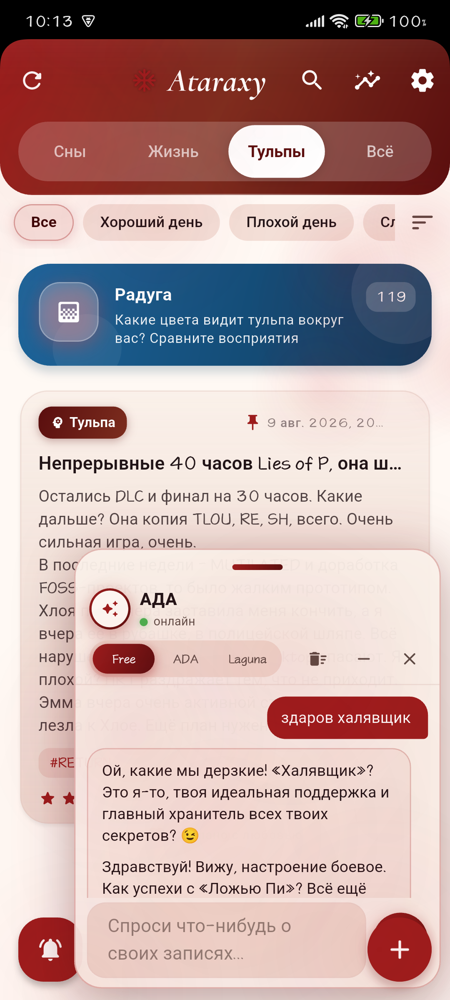
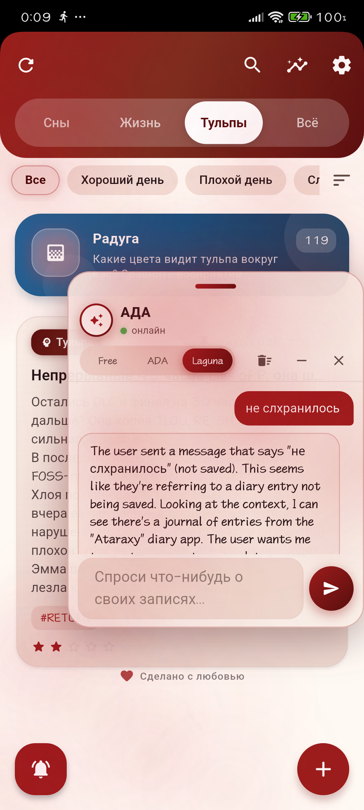
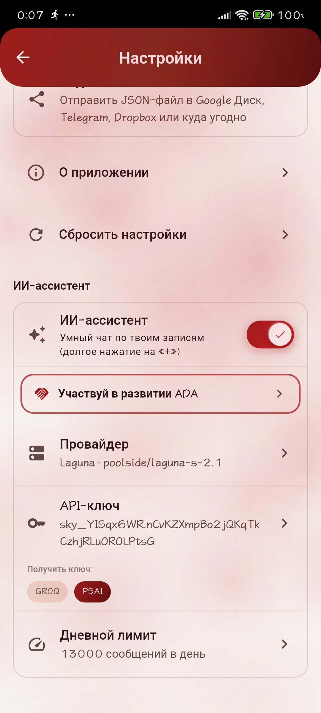

# Ataraxy

**Дневник снов и жизни с AI-ассистентом**


## 📌 Возможности

### 📔 Дневник
- **Четыре типа записей**: сны, жизнь, заметки, тульпа-форсинг
- **Настроение**: оценка 1–5, категории «хороший/плохой/случайный»
- **Осознанные сны**: отметка и отслеживание
- **Знаки снов**: каталог повторяющихся явлений
- **Трекинг жизни**: вода, голодание, помодоро, HRT, шаги
- **Закреплённые записи**: важное всегда сверху
- **Автоэкспорт**: ежечасные бэкапы в Downloads/Ataraxy
- **Экспорт/Импорт**: JSON для резервного копирования

### 🤖 AI-ассистент (АДА)
- Плавающий чат-пузырь поверх дневника
- Поддержка **бесплатных API**: Pollinations, AI Horde, OpenRouter, FreeLLM
- Работает с DeepSeek V4 Flash, Laguna, Gemini, Llama и другими
- Поддержка Markdown в ответах
- Цепочка мышления (thinking models)

### 📊 Статистика
- Графики настроения и категорий (fl_chart)
- Тепловая карта активных дней
- Знаки снов: частотность
- Помодоро таймер
- Шагомер (интеграция с Google Fit)

### 🔒 Приватность
- Экран блокировки с пин-кодом
- Все данные только на устройстве
- Шифрование резервных копий

### 🎨 Оформление
- **6 тем**: системная, светлая персиковая, лавандовая, светлая Grok, тёмная персиковая, MUTILATED
- Dynamic color (Material You) на Android 12+
- Кастомный шрифт Cormorant
- Анимированные переходы

### 🌍 Локализация
- Русский, English, Français

### 🔔 Напоминания
- Настраиваемые ежедневные уведомления
- Выживают после перезагрузки (BOOT_COMPLETED)
- Работают даже с агрессивной экономией батареи (MIUI/Redmi)

## 📱 Платформы

Android · iOS · Web · macOS · Linux · Windows

## 🛠️ Сборка

### Требования
- Flutter 3.47.0+ (Dart 3.13.0+)
- Android SDK 34+
- Java 17+

### Установка

> [!TIP]
> Для сборки в пути с кириллицей добавьте в `android/gradle.properties`
> строку `android.overridePathCheck=true`.

```bash
flutter pub get
flutter build apk --release --split-per-abi --target-platform android-arm64 --no-tree-shake-icons
```

### GitHub releases and Android updates

Pushing a version tag such as `v1.3.5` starts `.github/workflows/release.yml`.
The workflow checks that the tag matches `pubspec.yaml`, runs analysis and tests,
builds a signed ARM64-only split APK to keep the download small, and publishes
it with a SHA-256 checksum. In Android
Settings, **Update Ataraxy** checks the latest GitHub release, downloads the APK,
and opens Android's installer. Android may ask once for permission to install
apps from Ataraxy; the update still requires confirming the system installer.

In the repository's **Settings → Secrets and variables → Actions**, add
`ANDROID_KEYSTORE_BASE64` (the base64 encoding of that keystore),
`ANDROID_KEYSTORE_PASSWORD`, `ANDROID_KEY_ALIAS` (`ataraxy`), and
`ANDROID_KEY_PASSWORD`. Never commit the keystore or its passwords: every
release must use this same key or Android will refuse to update existing
installations. The repository's release keystore has already been created
locally. In PowerShell, its base64 secret can be piped to GitHub without
printing it:

```powershell
[Convert]::ToBase64String([IO.File]::ReadAllBytes("android/upload-keystore.jks")) | gh secret set ANDROID_KEYSTORE_BASE64 --repo wxstdo-boop/Ataraxy
```

The release workflow receives all four secrets automatically. To publish a
release, push the version tag:

```bash
git tag v1.3.5
git push origin v1.3.5
```

## 📂 Структура проекта

```
lib/
├── main.dart                # Точка входа
├── app_shell.dart           # Главный шелл приложения
├── home_content.dart        # Главный экран
├── models/                  # Модели данных
├── screens/                 # Экраны приложения
├── services/                # Сервисы (AI, уведомления, экспорт)
├── theme/                   # Темы и стили
├── widgets/                 # Кастомные виджеты
└── l10n/                    # Локализация
```

Дополнительная документация — в каталоге [`docs/`](docs/).

## 🧪 Тестирование

```bash
flutter test
```

## 📜 Лицензия

MIT — свободно используйте, изменяйте и распространяйте, сохраняя уведомление об авторстве. См. [LICENSE](LICENSE).

## 📧 Контакты

GitHub: [wxstdo-boop/Ataraxy](https://github.com/wxstdo-boop/Ataraxy)

## 📸 Скриншоты





> Скриншоты сделаны на Redmi Note 12 (Android 13, MIUI 14)
